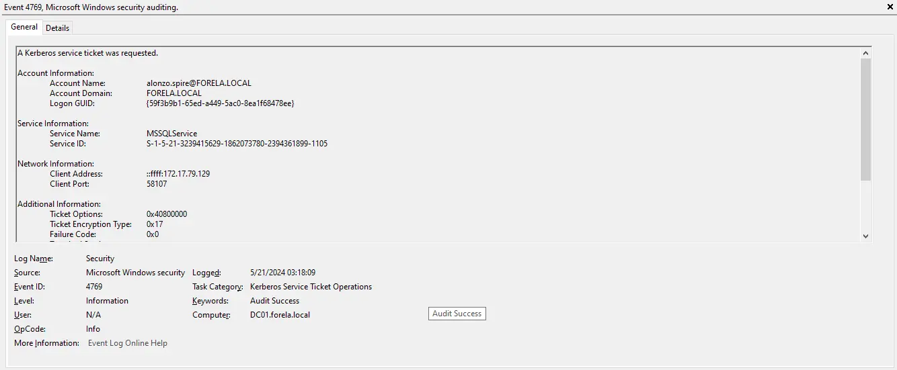
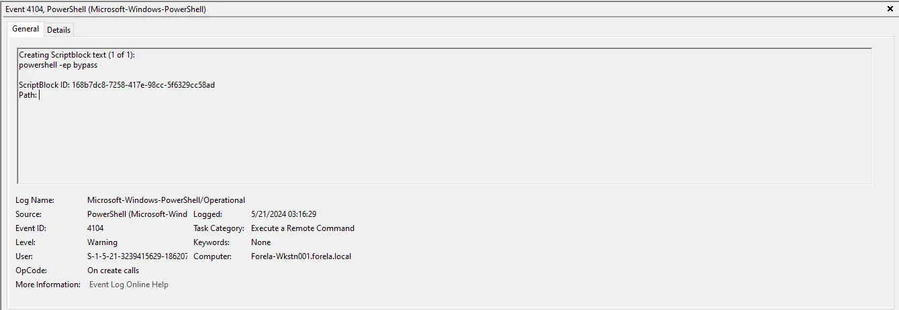
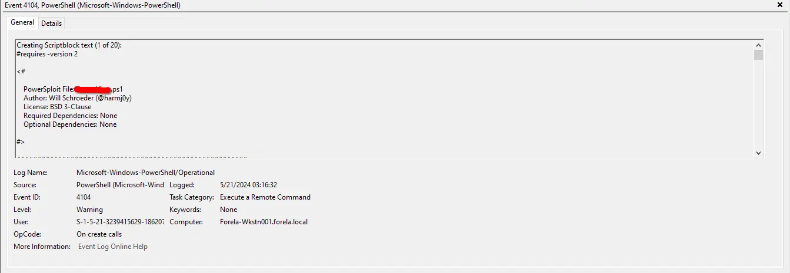
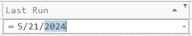
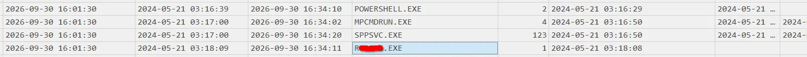

***
```text title="Scenario" wrap
Alonzo Spotted Weird files on his computer and informed the newly assembled SOC Team. Assessing the situation it is believed a Kerberoasting attack may have occurred in the network. It is your job to confirm the findings by analyzing the provided evidence.

You are provided with:

1- Security Logs from the Domain Controller

2- PowerShell-Operational Logs from the affected workstation

3- Prefetch Files from the affected workstation
```
***
## Tools used
- Windows Event Viewer
- [Eric Zimmerman's Tools](https://ericzimmerman.github.io/):
  - PECmd
  - Timeline Explorer

***
## Questions

> In order to have the correct time to answer properly the questions, we must **set the timezone to UTC**.

### Task 1
- Analyzing Domain Controller Security Logs, can you confirm the UTC date & time when the kerberoasting activity occurred?

In a Kerberoasting attack the attacker requests a service ticket and cracks it offline. RC4 is a legacy encryption type, and attackers prefer it because it's much easier to crack than AES, which is the default. So filter by **Event ID 4769** ( A Kerberos service ticket was requested ) and use **Find..** to search for **0x17** ( RC4 ) in the **Ticket Encryption Type**. Ignore machine accounts (names ending in `$`) and focus on the one that targets a service account.



<details>
<summary><b>Response: click to reveal</b></summary>

```ruby
2024-05-21 03:18:09
```

</details>

### Task 2 
- What is the Service Name that was targeted?

The response is the **service name** from Task 1 event.

<details>
<summary><b>Response: click to reveal</b></summary>

```ruby
MSSQLService
```

</details>

### Task 3 
- It is really important to identify the Workstation from which this activity occurred. What is the IP Address of the workstation? 

The response is the **client address** from the task 1 event.

<details>
<summary><b>Response: click to reveal</b></summary>

```ruby
172.17.79.129
```
</details>

### Task 4 
- Now that we have identified the workstation, a triage including PowerShell logs and Prefetch files are provided to you for some deeper insights so we can understand how this activity occurred on the endpoint. What is the name of the file used to Enumerate Active directory objects and possibly find Kerberoastable accounts in the network?

Look for **Event ID 4104** ( PowerShell Script Block Logging )  in the Powershell Operational logs. Taking a quick peek we can see that there is a PowerShell session launched with execution **policy bypass**  which is used to execute binary files without restrictions.



A couple of seconds later, the next log uses a **.ps1** file to perform active directory enumeration.



<details>
<summary><b>Response: click to reveal</b></summary>

```ruby
powerview.ps1
```
</details>

### Task 5 
- When was this script executed? (UTC)

From the events from Task 4, the first event is a policy execution bypass in order to execute the script for the first time, so the second event has the first execution of the script.

<details>
<summary><b>Response: click to reveal</b></summary>

```ruby
2024-05-21 03:16:32
```
</details>

### Task 6 
- What is the full path of the tool used to perform the actual kerberoasting attack?

First we must parse the prefetch files with **Eric Zimmerman's PECmd** to convert them into csv and then open it with Timeline explorer.

``` ruby
.\PECmd.exe -d "C:\Path\to\Prefetch\Folder\" --csv "C:\Destination\Folder\" --csvf result.csv
```

Once inside Timeline explorer filter by the date of the incident in the last run field:



After the filter is applied, there are the half of the events so its easier to find what we're looking for. Now **after powershell** there is a well known tool used to perform kerberoasting, Rubeus.exe.




<details>
<summary><b>Response: click to reveal</b></summary>

```ruby
C:\Users\Alonzo.spire\Downloads\Rubeus.exe
```
</details>

### Task 7 
- When was the tool executed to dump credentials? (UTC)

Look for the **last run** of the executable from task 6.

<details>
<summary><b>Response: click to reveal</b></summary>

```ruby
2024-05-21 03:18:08
```
</details>
***


